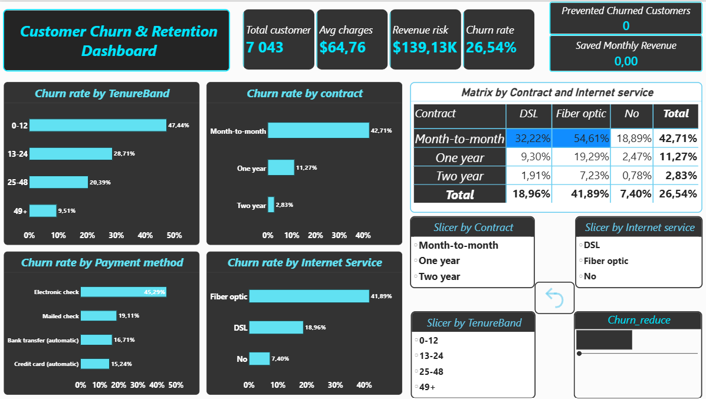
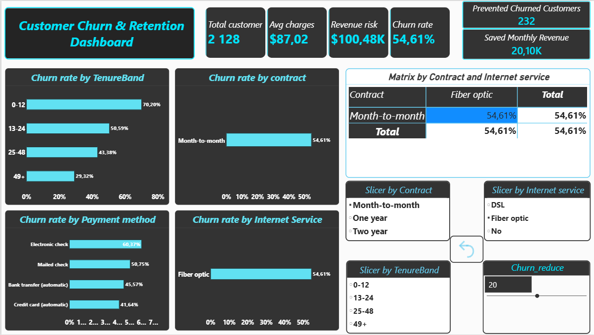

# 📊 Telco Customer Churn Analysis | Power BI

## 📌 Project Overview

This project focuses on analyzing customer churn in a telecommunications company using Power BI.

The main objective is to identify customer segments with high churn rates, understand the relationship between customer characteristics and churn, and provide actionable recommendations to improve customer retention.

An interactive Power BI dashboard was developed to analyze churn across contract types, internet services, payment methods, and customer tenure.

## 🛠️ Tools & Technologies

- **Power BI Desktop** — Data visualization and interactive dashboard development
- **Power Query** — Data cleaning and transformation
- **DAX** — Calculated measures and business metrics
- **What-if Analysis** — Customer retention scenario analysis

## 📂 Dataset

**Dataset:** Telco Customer Churn

**Source:** Kaggle — Telco Customer Churn Dataset

**Dataset Overview:**
- 7,043 customer records
- 21 original columns
- Customer demographics, subscription information, payment methods, and churn status

## 🔄 Data Cleaning & Transformation

The dataset was imported into Power BI and transformed using Power Query before loading it into the data model.

The following operations were performed:

1. Examined the dataset structure, data types, duplicate records, and missing values.
2. Corrected column data types where necessary.
3. Replaced missing values in the `TotalCharges` column with 0.
4. Created a `TenureBand` column to categorize customers based on their subscription duration.
5. Created a `ChargeBand` column to group customers based on monthly charges.
6. Created a numeric `ChurnFlag` column to represent customer churn status.
7. Applied the transformations using **Close & Apply**.

All data cleaning and transformation operations were performed in Power Query.

## 🧮 DAX Measures

The following measures were created to support the analysis:

| Measure | Description |
|---|---|
| Total Customers | Total number of customers |
| Churned Customers | Number of customers who left the company |
| Churn Rate | Percentage of customers who churned |
| Average Monthly Charges | Average monthly payment per customer |
| Monthly Revenue at Risk | Total monthly charges associated with churned customers |
| Prevented Churned Customers | Estimated number of customers retained under a selected scenario |
| Saved Monthly Revenue | Estimated monthly revenue saved under a selected scenario |

The analysis primarily used DAX functions such as `CALCULATE`, `DIVIDE`, `SUM`, `AVERAGE`, and `COUNTROWS`.

## 📈 Dashboard Features

The interactive Power BI dashboard includes:

### Key Performance Indicators

- Total Customers
- Average Monthly Charges
- Churn Rate
- Monthly Revenue at Risk

### Churn Analysis

Churn rates were visualized across four categories:

- Contract Type
- Internet Service
- Payment Method
- Tenure Band

### Interactive Features

**Slicers:** Allow users to filter the dashboard by different customer characteristics.

**Reset Bookmark:** Enables users to restore the dashboard to its initial state.

**Matrix Visualization:** Compares churn rates across Contract and Internet Service categories.

**Conditional Formatting:** Highlights churn rates above the overall churn rate of 26.54% in blue.

**Report Page Tooltip:** Displays additional information, including customer counts, churned customers, and revenue at risk, when hovering over contract categories.

**What-if Analysis:** Allows users to estimate the potential number of retained customers and monthly revenue savings under different churn reduction scenarios.

## 💡 Key Business Insights

### 1. Overall Customer Churn

The dataset contains **7,043 customers**, with an average monthly charge of approximately **$65** per customer.

The overall churn rate is approximately **26.54%**.

### 2. Customer Tenure and Churn

Customers in the first 12 months have the highest churn rate, approximately **47%**.

Customers with a tenure of 49 months or more have the lowest churn rate, approximately **9.51%**.

These results suggest that customer retention is particularly important during the first year.

### 3. Contract Type and Churn

Month-to-month contracts have the highest churn rate, approximately **43%**.

Within this category:

- Total Customers: **3,875**
- Churned Customers: **1,655**
- Monthly Revenue at Risk: Approximately **$120K**

In comparison, one-year contracts have approximately **$14K** in monthly revenue at risk.

### 4. Payment Method and Internet Service

Customers using Electronic Check have the highest churn rate among payment methods, approximately **45%**.

Among internet services, Fiber Optic customers have the highest churn rate, approximately **42%**.

### 5. Highest-Risk Customer Segment

Customers using Fiber Optic internet services with Month-to-month contracts have a churn rate of **54.61%**.

This segment represents a particularly important area for customer retention analysis.

### 6. What-if Analysis Results

A scenario involving a **20% reduction in customer churn** suggests that the company could potentially:

- Retain approximately **374 customers**
- Save approximately **$27K in monthly revenue**

These results are scenario-based estimates rather than guaranteed business outcomes.

## 🎯 Business Recommendations

### 1. Improve Customer Experience During the First Year

**Priority: High**

The highest churn rate occurs among customers within their first 12 months.

The company should investigate the quality of services provided during this period and evaluate customer satisfaction.

Based on the findings, targeted retention initiatives could be introduced to improve the customer experience.

### 2. Investigate Customer Contract Preferences

**Priority: High**

Month-to-month customers have significantly higher churn rates than customers with one-year or two-year contracts.

The company should investigate why customers prefer monthly contracts over longer-term agreements.

One possible explanation is that the conditions of longer-term contracts may not be sufficiently attractive.

Reviewing contract terms and evaluating incentives for longer commitments could help reduce churn.

### 3. Evaluate Fiber Optic Service Quality

**Priority: High**

Fiber Optic customers with Month-to-month contracts have particularly high churn rates.

The company should investigate potential issues related to Fiber Optic services, including service quality, pricing, and customer satisfaction.

The findings could help identify opportunities to improve service quality and reduce customer churn.

## 📁 Repository Structure

```text
telco-customer-churn-powerbi/
│
├── README.md
├── note.md
├── churn_dashboard.pbix
│
└── screenshots/
    ├── dashboard_overview.png
    └── dashboard_filtered.png
```

## 📷 Dashboard Screenshots

### Dashboard Overview



### Filtered Dashboard



## 📌 Conclusion

The analysis indicates that customer churn is strongly associated with contract type, customer tenure, internet service, and payment method.

The most significant churn risks are observed among customers with short tenure, month-to-month contracts, and Fiber Optic internet services.

The interactive dashboard enables business stakeholders to explore these patterns, identify high-risk customer segments, and evaluate potential retention scenarios.

The findings can support more targeted customer retention strategies and help the company prioritize areas with significant potential revenue impact.
